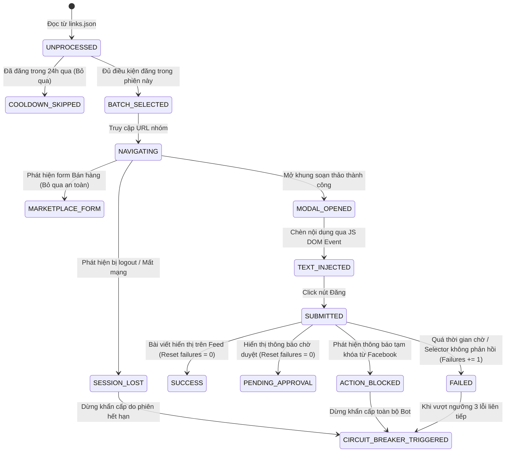

# ARCHITECTURE.md - Kiến Trúc Hệ Thống & Luồng Vận Hành Facebook Automation Bot

Tài liệu này chuẩn hóa toàn bộ kiến trúc kỹ thuật, luồng công việc (End-to-End Workflow), và chiến lược xử lý lỗi biên của dự án **Facebook Automation Bot** theo nguyên tắc **The Pragmatic Programmer** và tiêu chuẩn kỹ thuật trong [GEMINI.md](file:///Users/teomoney/Documents/facebook_automation/GEMINI.md).

---

## 1. Ý TƯỞNG CỐT LÕI & BÀI TOÁN NGHIỆP VỤ

### 1.1. Bối cảnh nghiệp vụ
- **Mục tiêu**: Tự động hóa đăng tải nội dung định kỳ (tuyển dụng, thông tin sản phẩm) lên hàng chục hội nhóm Facebook chuyên ngành.
- **Bài toán đặt ra**: Facebook liên tục siết chặt cơ chế kiểm soát bot; các giải pháp tự động hóa thô sơ dùng delay cố định, chiếm dụng clipboard người dùng hoặc cố đăng dồn dập sẽ lập tức bị thuật toán AI của Meta kích hoạt checkpoint hoặc khóa tài khoản vĩnh viễn (*Action Blocked / Banned*).

### 1.2. Triết lý thiết kế: "Human-Centric & Resilience First"
1. **An toàn tài khoản là ưu tiên số một**: Mọi quyết định kỹ thuật ưu tiên sự bền vững của tài khoản hơn tốc độ. Thà dừng sớm (Crash Early) khi có rủi ro còn hơn cố chạy để rồi bị mất tài khoản.
2. **Không xâm phạm người dùng (Non-intrusive)**: Không sử dụng OS Clipboard (`pyperclip`). Thay vào đó, chèn văn bản qua JavaScript Native DOM Events (`document.execCommand('insertText')` + `InputEvent`), giúp người dùng tiếp tục làm việc bình thường trên máy tính trong khi bot hoạt động.
3. **Trung thực theo Design by Contract**: Không giả định click là thành công. Mọi bài đăng đều phải được hậu kiểm thực tế trên DOM xem bài đã lên feed thật hay rơi vào danh sách chờ duyệt (Pending) hoặc bị chặn.

---

## 2. PHÂN RÃ 5 MODULE (CLEAN ARCHITECTURE)

```
facebook_automation/
├── config.py              # [Module 1] Cấu hình tập trung, Immutable Dataclass, Fail-Fast
├── helpers/
│   └── logger.py          # [Module 1] Structured Logging, Rotating File Handler, Screenshots
├── browser/
│   ├── driver_manager.py  # [Module 2] Chrome Lifecycle, Port 9224 Cleanup, Stealth Patch
│   ├── dom_actions.py     # [Module 2] Safe Click, Smart Wait, JS DOM Text Injection, Fallback Selector Resolver
│   └── dom_inspector.py   # [Module 2] Tự động quét & báo cáo sức khỏe DOM (--check-dom / Canary Check)
├── services/
│   ├── state_manager.py   # [Module 3] Lưu vết json/history.json, Cooldown 24h, Batching
│   ├── post_verifier.py   # [Module 4] Thanh tra DOM, PostStatus Enum (Success/Pending/Blocked)
│   └── circuit_breaker.py # [Module 4] Ngắt mạch khẩn cấp khi bị phạt, Reset counter khi thành công
├── facebookbot.py         # [Module 5] Orchestrator tinh gọn (< 100 dòng điều phối các service)
└── main.py                # [Module 5] CLI Entrypoint & Báo cáo tổng kết
```

---

## 3. WORKFLOW TỔNG THỂ TỪ A - Z (7 GIAI ĐOẠN)

```mermaid
flowchart TD
    Start(["🚀 Bắt đầu chương trình"]) --> InitConfig["Giai đoạn 1: ConfigManager<br/>Đọc & Validate .env, links, posts, xpaths (Fail-Fast)"]
    
    InitConfig --> CheckConfig{"Cấu hình hợp lệ?"}
    CheckConfig -- "❌ Thiếu dữ liệu" --> AbortConfig["Dừng khẩn cấp: Crash Early"]
    CheckConfig -- "✅ Hợp lệ" --> PreSanitation["Giai đoạn 2: BrowserManager<br/>Dọn dẹp cổng 9224 & Xóa SingletonLock kẹt"]

    PreSanitation --> LaunchChrome["Khởi chạy Chrome Native Profile & CDP Stealth Patch"]
    LaunchChrome --> CheckAuth["Giai đoạn 3: Kiểm tra Session Facebook"]

    CheckAuth --> IsLoggedIn{"Đã đăng nhập?"}
    IsLoggedIn -- "❌ Chưa" --> AutoFillLogin["Điền Email & Mật khẩu (Human Typing Simulation)"]
    AutoFillLogin --> Check2FA{"Có CAPTCHA / 2FA?"}
    Check2FA -- "Có" --> HumanLoop["Tạm dừng: Human-in-the-loop<br/>(Người dùng tự giải quyết 2FA trên trình duyệt)"]
    HumanLoop --> WaitForFeed["Chờ người dùng nhấn Enter & Feed hiển thị"]
    Check2FA -- "Không" --> WaitForFeed
    WaitForFeed --> FilterGroups
    IsLoggedIn -- "✅ Rồi" --> FilterGroups["Giai đoạn 4: StateManager<br/>Lọc Cooldown 24h & Cắt Batch (5-10 nhóm)"]

    FilterGroups --> HasEligibleGroups{"Còn nhóm cần đăng?<br/>(Danh sách batch > 0)"}
    HasEligibleGroups -- "❌ Rỗng (Tất cả đang cooldown)" --> GenEmptyReport["Thông báo: Tất cả nhóm đang trong thời gian nghỉ 24h"] --> GenReport
    
    HasEligibleGroups -- "✅ Có nhóm" --> LoopBatch["Bắt đầu Giai đoạn 5: Vòng lặp đăng bài"]
    LoopBatch --> CheckBatch{"Còn nhóm trong Batch?"}
    CheckBatch -- "Hết nhóm" --> GenReport["Giai đoạn 7: Báo cáo & Dọn dẹp<br/>In bảng tổng kết & Lưu state.json"]
    
    CheckBatch -- "Còn nhóm" --> NextGroup["Lấy nhóm tiếp theo"]
    NextGroup --> JitterDelay["Áp dụng Jitter Cooldown (Nghỉ 45s - 90s)"]
    JitterDelay --> NavGroup["Truy cập URL Group"]

    NavGroup --> QuickHealthCheck{"Kiểm tra nhanh Session & Mạng?"}
    QuickHealthCheck -- "❌ Bị Logout / Mất mạng" --> HandleSessionLost["Phát hiện mất Session/Mạng:<br/>Không tính lỗi bài đăng, dừng an toàn"] --> TriggerCircuitBreaker
    
    QuickHealthCheck -- "✅ Session OK" --> OpenModal["Click mở khung soạn thảo"]
    OpenModal --> DetectMarketplace{"Có bị ép vào Form Bán hàng?"}
    DetectMarketplace -- "Có" --> HandleMarketplace["Ghi nhận MARKETPLACE_FORM, Bỏ qua nhóm<br/>(Không tính lỗi consecutive_failures)"] --> CheckBatch
    
    DetectMarketplace -- "Không" --> InjectText["Chèn văn bản bằng JS DOM Native Event<br/>(Không chiếm Clipboard máy tính)"]
    InjectText --> ClickPost["Click nút Đăng (Post Button)"]

    ClickPost --> VerifyPost["Giai đoạn 6: PostVerifier<br/>Hậu kiểm phản hồi DOM"]
    VerifyPost --> InspectDOM{"Trạng thái bài viết?"}

    InspectDOM -- "Bài lên Feed" --> StatusSuccess["Trạng thái: SUCCESS<br/>Reset consecutive_failures = 0<br/>Cập nhật timestamp vào state.json"] --> CheckBatch
    InspectDOM -- "Chờ Admin duyệt" --> StatusPending["Trạng thái: PENDING_APPROVAL<br/>Reset consecutive_failures = 0<br/>Vẫn tính Cooldown 24h"] --> CheckBatch
    InspectDOM -- "Bị khóa tính năng" --> StatusBlocked["Trạng thái: ACTION_BLOCKED<br/>Tự động chụp ảnh màn hình chứng cứ"] --> TriggerCircuitBreaker["🚨 KÍCH HOẠT CIRCUIT BREAKER!<br/>Dừng ngay toàn bộ chuỗi đăng bài"]
    InspectDOM -- "Lỗi không xác định" --> StatusFail["Trạng thái: FAILED<br/>consecutive_failures += 1<br/>Chụp ảnh màn hình lưu vào logs/"] --> CheckFailStreak{"Lỗi liên tiếp >= 3?"}
    
    CheckFailStreak -- "Có" --> TriggerCircuitBreaker
    CheckFailStreak -- "Không" --> CheckBatch

    TriggerCircuitBreaker --> GenReport
    GenReport --> CleanUp["Giải phóng Driver, Đóng Port & Tắt RAM Chrome"]
    CleanUp --> End(["🏁 Kết thúc quy trình an toàn"])
```



---

### Chi tiết 7 giai đoạn vận hành:

1. **Bootstrapping & Config Validation**: Đọc và xác thực cấu hình (`.env`, `xpaths.json`, `links.json`, `posts.json`). Ném `ConfigurationError` dừng ngay nếu thiếu credential hoặc cấu hình sai lệch.
2. **Browser Lifecycle & Resource Sanitation**: Tìm và kill tiến trình kẹt cổng `9224`, xóa file `SingletonLock` của Chrome profile cũ nếu còn sót; khởi tạo Chrome với Stealth CDP. Đóng gói trong Context Manager đảm bảo luôn dọn dẹp RAM.
3. **Authentication & Human-in-the-loop**: Nhận diện trạng thái đăng nhập qua thanh tìm kiếm. Nếu chưa đăng nhập, tự động điền form; khi phát hiện 2FA/CAPTCHA, tạm dừng để người dùng xử lý trực tiếp trên trình duyệt rồi tiếp tục.
4. **Smart Group Filtering & Batching**: 
   - Đối chiếu `json/history.json`, tự động bỏ qua nhóm đã đăng trong vòng 24 giờ.
   - **Fast-Exit**: Nếu danh sách nhóm hợp lệ rỗng (tất cả đều đang trong thời gian cooldown 24h), bot lập tức ghi log thông báo và chuyển thẳng sang Giai đoạn 7 để thoát an toàn, không mở trình duyệt vô ích.
   - Chỉ cắt một lô (batch) từ 5–10 nhóm cho mỗi phiên chạy.
5. **Safe Posting Execution Loop**: 
   - Áp dụng thời gian nghỉ ngẫu nhiên (Jitter 45s–90s) giữa các nhóm.
   - **Mid-Flight Session & Network Health Check**: Trước khi thao tác, kiểm tra nhanh xem URL có bị đẩy về `facebook.com/login` hay gặp lỗi ngắt mạng không. Nếu mất session/mạng, dừng ngay với cảnh báo chuyên biệt thay vì cố click rồi tính là lỗi đăng bài.
   - Sử dụng JS Native Event để bơm văn bản tiếng Việt/emoji vào DOM Facebook an toàn (không đè clipboard).
6. **Post Verification & Circuit Breaker**: 
   - Phân loại chính xác 5 trạng thái: `SUCCESS`, `PENDING_APPROVAL`, `ACTION_BLOCKED`, `MARKETPLACE_FORM`, `FAILED`.
   - **Quy tắc Reset Lỗi Liên Tiếp**: Khi một nhóm đạt `SUCCESS` hoặc `PENDING_APPROVAL`, biến đếm `consecutive_failures` được reset về `0`.
   - Kích hoạt ngắt mạch khẩn cấp khi phát hiện bị chặn tính năng (`ACTION_BLOCKED`) hoặc `consecutive_failures >= 3`.
7. **Observability & Graceful Teardown**: Ghi log xoay vòng `logs/bot.log` (tối đa 5MB), tự chụp ảnh màn hình khi có lỗi, xuất bảng tổng kết và đóng trình duyệt sạch sẽ.

---

## 4. MÁY TRẠNG THÁI BÀI VIẾT (POST STATUS STATE MACHINE)



---

## 5. CHIẾN LƯỢC XỬ LÝ CÁC KỊCH BẢN BIÊN (EDGE CASES)

| Kịch bản biên | Hiện tượng thực tế | Giải pháp kiến trúc |
| :--- | :--- | :--- |
| **Tất cả nhóm đang Cooldown** | File `history.json` ghi nhận toàn bộ nhóm đã đăng < 24h. | Nhánh `HasEligibleGroups` nhận diện danh sách rỗng, ghi log thông báo và kết thúc phiên sớm, không chạy vòng lặp vô nghĩa. |
| **Mất Session / Logout giữa chừng** | Đang đăng bài thì Facebook bắt checkpoint hoặc phiên cookie bị thu hồi, URL bị redirect về `/login`. | `QuickHealthCheck` phát hiện URL đổi về trang đăng nhập; lập tức kích hoạt `SessionExpiredError`, ngắt mạch dừng bot và cảnh báo người dùng thay vì ghi nhận lỗi bài đăng FAILED. |
| **Nhóm Mua & Bán (Marketplace)** | Click mở bài đăng bị chuyển sang form "Bạn đang bán gì?" (yêu cầu giá, tiêu đề). | Tự động chuyển tab "Thảo luận" (Discussion). Nếu vẫn bị ép form, gắn nhãn `MARKETPLACE_FORM`, bỏ qua an toàn và không tính vào biến đếm lỗi `consecutive_failures`. |
| **Nội quy nhóm / Khảo sát** | Xuất hiện modal phụ yêu cầu tick đồng ý quy tắc hoặc trả lời câu hỏi. | Tự động tick checkbox nội quy. Nếu là câu hỏi khảo sát bắt buộc, chụp ảnh màn hình lưu vết và chuyển nhóm tiếp theo. |
| **Bị Facebook chặn tính năng** | Xuất hiện popup thông báo *"Bạn tạm thời bị chặn sử dụng tính năng này..."*. | `PostVerifier` phát hiện ngay, kích hoạt `CircuitBreaker` dừng bot lập tức, chụp ảnh bằng chứng để bảo vệ tài khoản. |
| **Lỗi FAILED ngẫu nhiên** | Một nhóm bị lỗi mạng nhẹ hoặc đổi selector. | Tăng `consecutive_failures += 1`. Nếu nhóm kế tiếp thành công (`SUCCESS`/`PENDING`), reset `consecutive_failures = 0`. Chỉ ngắt khi dính 3 lỗi liên tiếp. |
| **Kẹt cổng 9224 / File lock** | Đóng terminal đột ngột khiến tiến trình Chrome chạy ngầm kẹt port 9224. | Khởi động quy trình Pre-flight Sanitation: tìm PID chiếm cổng 9224 để kill và xoá file `SingletonLock` rác trước khi mở browser. |

---

## 6. QUẢN LÝ CẤU TRÚC DOM & PHÁT HIỆN BIẾN ĐỘNG (DOM DRIFT DETECTION)

### 6.1. Tách biệt cấu trúc DOM vào Registry riêng (`json/selectors.json`)
- Áp dụng nguyên tắc **Orthogonality** & **Page Object Model**: Tách rời 100% selector khỏi logic code.
- Mỗi phần tử được định nghĩa dưới dạng **Primary + Fallback List**:
  ```json
  {
    "content_bar": [
      "//div[@role='button']//span[contains(text(), 'Write something')]",
      "//div[@role='button']//span[contains(text(), 'Bạn viết gì đi')]",
      "//div[@role='region']//div[@role='button'][descendant::span]"
    ]
  }
  ```
- **Self-Healing Automation**: Khi selector chính (Primary) bị Facebook đổi, `dom_actions.py` tự động thử các selector fallback tiếp theo, giúp bot không bị dừng đột ngột.

### 6.2. Công cụ Tự động Quét Sức khỏe DOM (`dom_inspector.py`)
- Cung cấp cờ lệnh kiểm tra định kỳ: `python repo/main.py --check-dom`.
- **Cơ chế**:
  1. Mở Chrome truy cập nhóm mẫu trong `exceptional_links.json`.
  2. Lần lượt dò quét toàn bộ các phần tử trong `selectors.json`.
  3. Xuất bảng **DOM Health Report**:
     - `PASS`: Khớp selector chính.
     - `WARN`: Selector chính hỏng, đang chạy bằng fallback (Cần lên kế hoạch cập nhật JSON).
     - `BROKEN`: Toàn bộ selector chính & fallback đều không tìm thấy (Cần chụp ảnh màn hình và cập nhật selector ngay).
  4. Nếu có phần tử `BROKEN`, bot tự động chụp ảnh màn hình và trích xuất HTML snippet vùng đó lưu vào `logs/dom_drift/` phục vụ debug nhanh.


---

## 7. MÔ HÌNH HỢP TÁC ĐA TÁC NHÂN (MULTI-AGENT TEAM ROLES)

Để đảm bảo chất lượng kỹ thuật cao nhất và tuân thủ chặt chẽ [GEMINI.md](file:///Users/teomoney/Documents/facebook_automation/GEMINI.md) cũng như quy tắc **The Pragmatic Programmer**, dự án áp dụng mô hình phân tách vai trò đa tác nhân (Multi-Agent Sub-agents) độc lập:

| Tác nhân (Sub-Agent) | Vai trò & Trách nhiệm | Công cụ & Đầu ra |
| :--- | :--- | :--- |
| **Foundation Architect** | • Thiết kế nền tảng hạ tầng, quản lý cấu hình, logging, driver lifecycle.<br/>• Đảm bảo tính độc lập và đóng gói tài nguyên sạch sẽ (Resource Management). | • `repo/config.py`<br/>• `repo/helpers/logger.py`<br/>• `repo/browser/driver_manager.py` |
| **Workflow & Architecture Specialist** | • Chuẩn hóa toàn bộ quy trình nghiệp vụ từ A - Z (7 giai đoạn).<br/>• Thiết kế cỗ máy trạng thái `PostStatus`, nhận diện và xử lý kịch bản biên (Edge Cases). | • `ARCHITECTURE.md`<br/>• Flowchart & State Machine Diagrams |
| **Code Quality & Production Reviewer (`code-reviewer`)** | • Thanh tra độc lập kiểm duyệt từng file mã nguồn trước khi merge.<br/>• Kiểm tra tính tuân thủ `GEMINI.md`, `Ponytail`, Zero Silent Failure, bảo mật mật khẩu, chống rò rỉ clipboard và rò rỉ RAM/process.<br/>• Thực thi Unit Test và phát hiện code smells, lỗ hổng tiềm ẩn. | • Báo cáo Code Review chi tiết<br/>• Phán quyết nghiệm thu: `[APPROVE]` hoặc `[REQUEST CHANGES]` |
